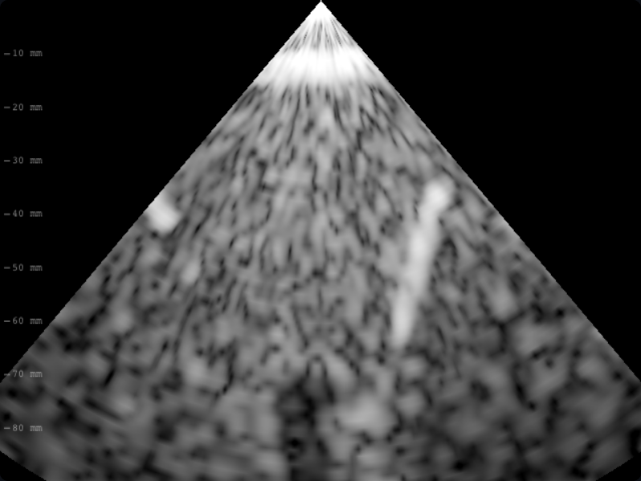
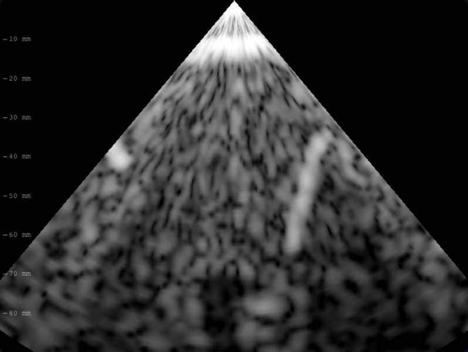

# B04 · Pérdida de ventana en B-mode y lateralidad

Diagnóstico: `inTemporalWindow` ignoraba el lado; por eso su llamada «der» en
atenuación ya incluía ambas ventanas. No existía la supuesta pérdida unilateral
Doppler. El defecto observable es otro: la calidad de ventana penaliza Doppler
pero no B-mode a geometría idéntica. Enseña una imagen conservada sin motivo.
Mecanismo: compartir pérdida de transmisión y aplicarla al abandonar hueso hacia
el interior craneal por una ventana; no oscurecer piel ni ruido receptor. Hacer
explícita la pertenencia lateral y comprobar ambas ventanas en atenuación.
Predicción: reducir calidad a mitad reduce la amplitud intracraneal a mitad,
conserva escena, señal extracraneal y valor de referencia. No modela aberración.
Refutación: señal profunda intacta, asimetría derecha/izquierda o piel atenuada.

Verificación: tres regresiones fallan en main y pasan con el cambio; 327 pruebas
pasan en `npm run check`, incluidos los siete dorados sin modificación.
Capturas reales Playwright: caso ventanaPobre, temporal derecha, 2 MHz,
90 mm, foco 50 mm, ganancia 14 dB, salida 0 dB, semilla 20261012, t=0,4 fijo.

El cambio atenúa el retorno intracraneal; no demuestra validez clínica externa
ni incorpora aberración de fase. Paridad CPU/WebGL2 verificada en ojo y temporal.

Límite comprobado en revisión: la relación de amplitud 1/2 se exige a la señal
imaginaria difusa; la energía IQ total profunda también debe disminuir. No
se exige esa relación a todas las réplicas reales simplificadas: su pérdida
completa por ventana sigue pendiente. B01 separa ruido y emisión, pero eso por
sí solo no resuelve el trayecto físico de cada réplica. No se afirma que toda
la imagen conserve una relación exacta de transmisión.
