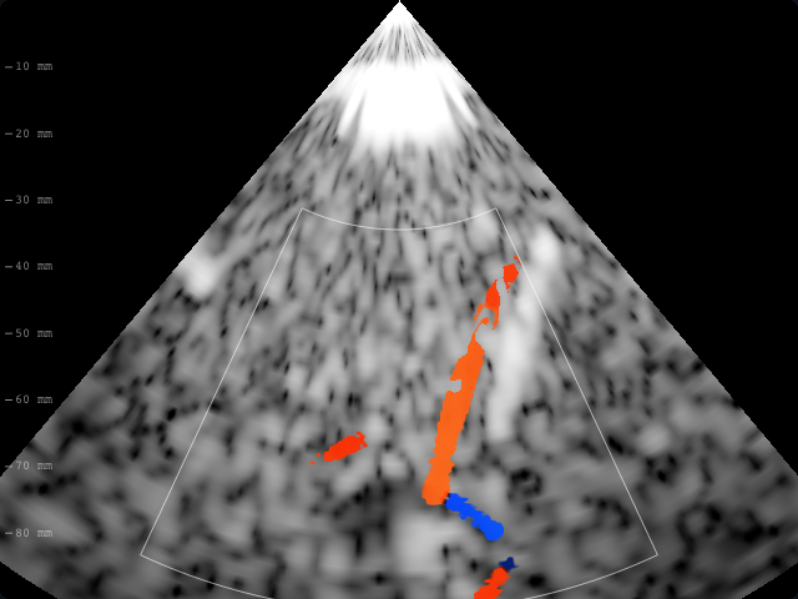
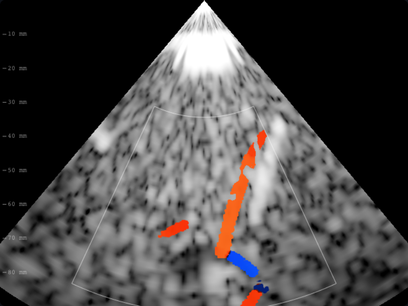

# B05 · Ganancia Doppler color

Defecto: ganancia multiplicaba numerador y referencia de potencia; se cancelaba.
El control no alteraba color ni su umbral de aceptación. Mecanismo: aplicar
la ganancia receptora solamente a potencia detectada, con referencia fija.
Invariantes: velocidad, varianza y geometría de las celdas comunes, señal IQ,
respuesta a ganancia cero. Refutación: +10 dB no multiplica por diez la potencia
no saturada o modifica la velocidad. Una regresión falla antes y pasa después.
Es una corrección del control educativo, sin calibración clínica externa.

Verificación: `npm run check` pasa (325 pruebas), y el flujo docente E2E pasa.
Solo cambian los dorados color M1 y ACI; ojo, B-mode y PW permanecen idénticos.
Capturas de la app: temporal derecha normal, 2 MHz, 90 mm, color activado,
ganancia Doppler de configuración 8 dB, semilla 20261012 y reloj fijo t=0,4.
La interfaz actual no expone un deslizador de ganancia Doppler; la regresión
varía ese parámetro de adquisición directamente.

