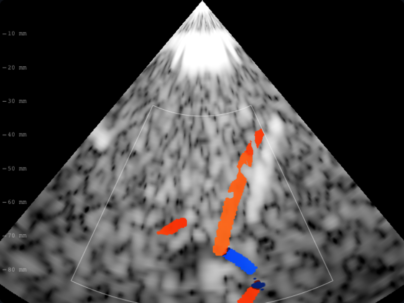

# B07 · Volumen de muestra sectorial

Defecto: la anchura angular de cada celda sectorial se usaba como milímetros,
y su eje lateral permanecía fijo aunque el haz girase. El ensemble muestreaba
una lámina artificialmente estrecha y oblicua al haz. Mecanismo: semiancho
z*tan(pasoAngular/2) y tangente unitaria perpendicular al haz local.

Invariantes: celdas centrales, eje axial, sonda lineal, PRF, ruido y umbrales.
Refutación: doble profundidad debe duplicar ancho; base tangente debe ser
ortogonal fuera del eje. Dos pruebas fallan con la expresión previa extraída
sin cambio de comportamiento; la tercera conserva la geometría lineal.
La celda rectangular sigue siendo aproximación local, no integración exacta
sobre un sector curvo. Sin validación clínica externa.

`npm run check`: 329 pruebas aprobadas. Cambian los dos dorados sectoriales
(M1 y ACI); color ocular lineal, B-mode y PW permanecen idénticos.
Depende de B06, que corrige la identificación de los trayectos de estas celdas.

Captura real de la app, temporal derecha, 2 MHz, 90 mm, color activado,
semilla 20261012 y reloj fijo t=0,4; compara con B05 bajo los mismos controles.

Revisión observable: `colorVolumeAcquisition.test.ts` ejecuta el generador
completo dos veces sobre la misma adquisición física, cambiando solo el eje
angular de referencia de la sonda y compensando el centro de la caja. Exige
misma disponibilidad y mapas de velocidad/potencia (tolerancias 0,001 cm/s y
0,00001). Falla ejecutado directamente en main, sin importar helpers nuevos,
y pasa con el volumen corregido. Prueba de simetría física, no un hash aislado.
