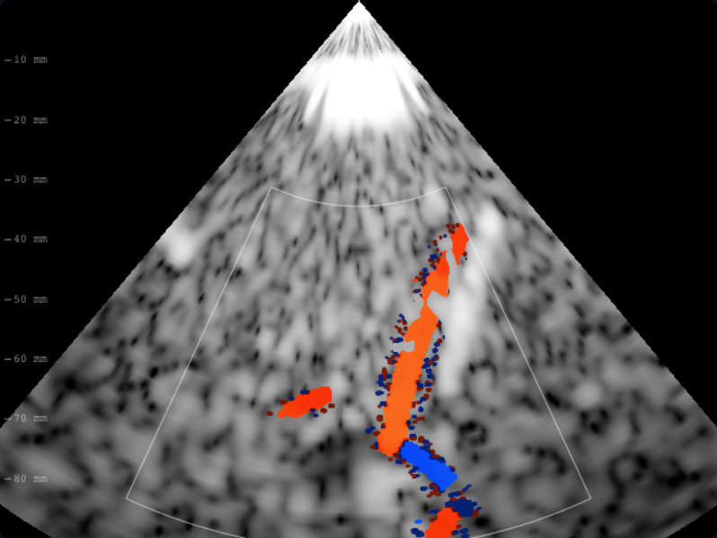

# B08 · Señal recibida y ruido receptor Doppler color

Defectos: transmisión multiplicaba ruido; después su cuadrado dividía potencia.
La pérdida podía conservar una velocidad falsa y llevar ruido puro a brillo
máximo. El detector separa ahora recepción, detección y presentación:

- Ruido electrónico fijo compartido con PW: sigma=0,0004, escala IQ existente.
- Después de quitar la media compleja, ruido gaussiano puro tiene 2(N−1)
  grados de libertad. Se rechaza potencia inferior a la cota superior
  sigma²[nu+2√(nu·ln(10000))+2ln(10000)]. Probabilidad teórica por celda ≤10⁻⁴.
- Se resta la potencia media de ruido de R0 para presentación. La referencia
  de brillo corresponde a SNR 20 dB (parámetro de presentación estimado),
  nunca dividida por transmisión ni
  calculada desde anatomía, caudal verdadero o calidad de ventana del paciente.
- Ganancia escala potencia de presentación; se conservan filtros de velocidad
  y varianza existentes. La ganancia no convierte ruido rechazado en flujo.

Fuente primaria de la cota: Hsu, Kakade y Zhang, Proposition 1,
<https://arxiv.org/html/1110.2842v1>. Es una aplicación a la proyección que
resta la media; no valida clínicamente el ruido estimado del simulador.

Refutación: sin eco o con pérdidas crecientes no debe persistir color saturado.
El fantoma sin eco llena toda la caja, usa cuatro semillas y ganancia +30 dB:
49152 celdas, cero falsas detecciones observadas. La cota teórica no significa
cero falsos positivos garantizados. El barrido 0/40/60/80/100/120/infinito dB
produce 893/840/842/533/0/0/0 celdas disponibles (semilla de referencia).

La prueba de ganancia usa una pérdida fija de 70 dB para mantener muestras sin
saturación con la nueva referencia receptora. Sigue exigiendo ×10 por +10 dB,
igualdad de velocidades/varianzas comunes y mayor aceptación, sin relajar
ninguna tolerancia. La caché se contrasta contra un cálculo sin caché sobre un
vaso fantoma que llena la caja y pérdida variable por fila; restaurar la clave
antigua falla tanto en consultas como en mapas observables.

Límites: ruido gaussiano conocido y fijo, ensembles cortos y filtro de pared
que solo resta media. El generador aún limita clutter a vecindades de vasos;
no se afirma validación de falsos positivos tisulares de todo el campo ni
sensibilidad clínica. Ningún resultado usa la verdad de flujo como medición.

Verificación final: `npm run check` pasa con 332 pruebas; las 11 E2E pasan.
Se mantienen velocidad M1 y signo ACR/VCR. Captura real temporal derecha,
2 MHz, 90 mm, color activado, semilla 20261012 y t=0,4 fijo:

El hash espacial se convierte de [0,1) a uint32 antes del XOR. La fracción
anterior se truncaba a cero, reutilizando la secuencia entre celdas. El test
instrumenta las gaussianas generadas por la adquisición y exige >99 % de
primeras muestras distintas, además de contar falsas detecciones. Dispersores
y ruido usan sales separadas. No se supone independencia clínica real.
