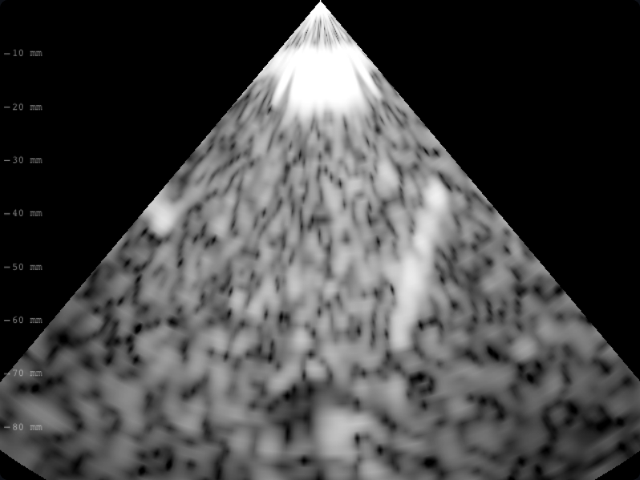

# B10 · Registro físico del barrido

Defecto: se remapeaban filas como centros de texel aunque la muestra zi
corresponde a zi*dz, y las líneas incluyen ambos extremos laterales. Eso
desplazaba tejido respecto de escala, caja color y calibres. Mecanismo: invertir
esas posiciones físicas en CPU y GPU y usar dzMm real, también en la clave LUT.

Invariantes: señal IQ, PSF, grises, geometría de presentación y Doppler. Refutación:
una rampa analítica conocida debe recuperar el gris en su coordenada física.
Dos pruebas (lineal/sector) fallan antes, pasan después. La prueba antigua de
rampa ahora evalúa centros interiores, manteniendo igualdad exacta de grises;
la referencia bilineal se actualiza al contrato físico, no se relajan umbrales.
No se afirma validación clínica externa ni corrección de velocidad del sonido.

Verificación: 326 pruebas de `npm run check`, siete dorados intactos y las
11 E2E completas aprobadas, incluidos calibres y paridad CPU/WebGL2.
Capturas reales: temporal derecha, 2 MHz, 90 mm, foco 50 mm, ganancia 14 dB,
semilla 20261012, reloj fijo t=0,4. El cambio es pequeño a resolución habitual;
la rampa analítica revela el error de registro sin exagerar su impacto visual.

